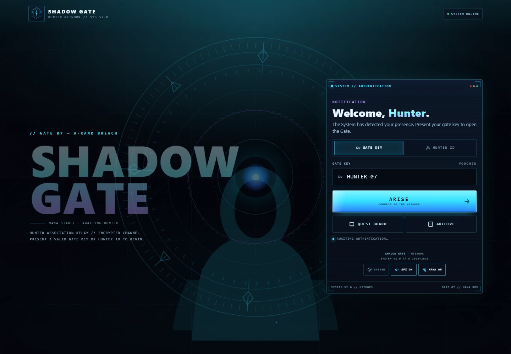
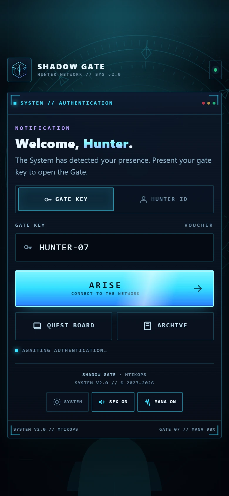
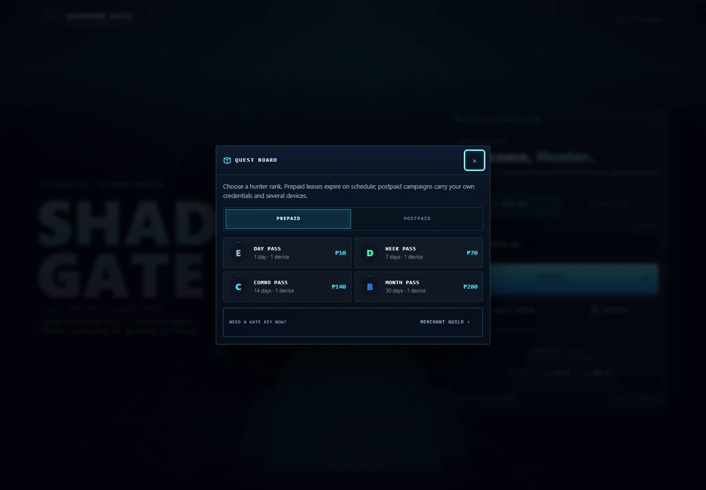
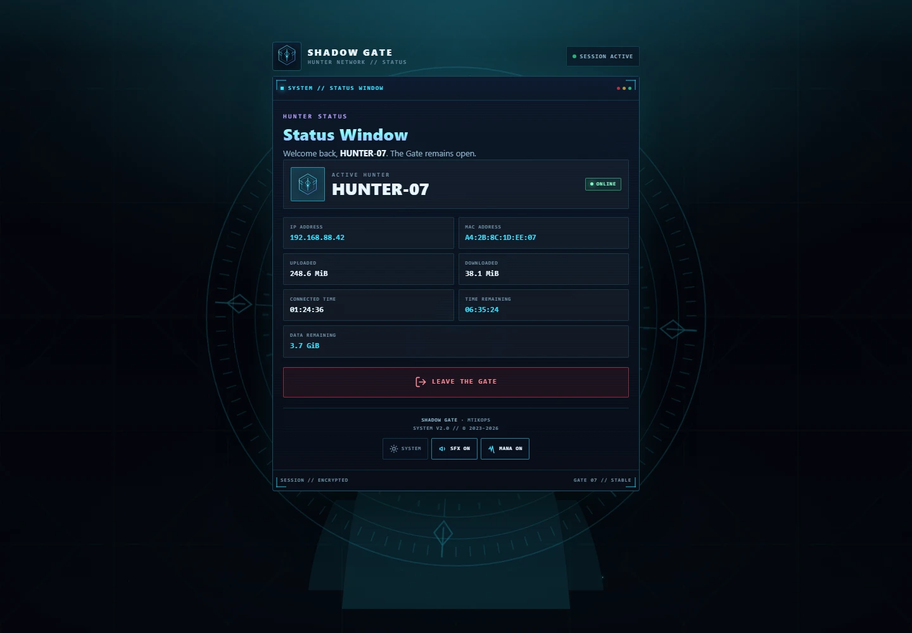
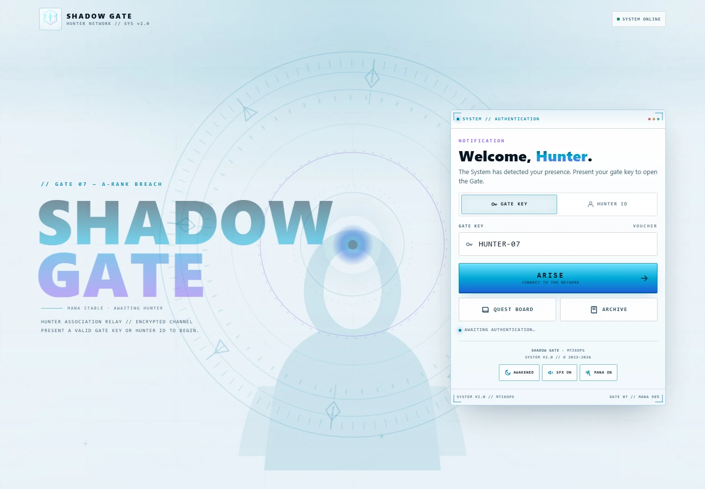

# SHADOW GATE

**A Solo Leveling–inspired MikroTik hotspot theme — the System, Gates, hunters, and mana, running entirely from your router.**

[](LICENSE)
[](https://mikrotik.com)
[](#-no-build-step)
[](#-accessibility)
[](#-contributing)

**SHADOW GATE** turns a standard MikroTik hotspot login into a holographic System window: a rotating Gate, hunter ranks, mana glow, system notifications, and an optional **Monarch Mode** easter egg.

Everything is self-hosted. No web fonts, no CDNs, no remote images, no build step, no frameworks. The portal works before the guest has internet — which is exactly when a captive portal has to work.



---

## Table of contents

- [Why this theme](#why-this-theme)
- [Screenshots](#screenshots)
- [Quick start](#quick-start)
- [Pages](#pages)
- [Configuration](#configuration)
- [Features](#features)
- [Performance tiers](#performance-tiers)
- [MikroTik compatibility](#mikrotik-compatibility)
- [Accessibility](#accessibility)
- [Browser support](#browser-support)
- [Project structure](#project-structure)
- [Asset budget](#asset-budget)
- [Notes and troubleshooting](#notes-and-troubleshooting)
- [Contributing](#contributing)
- [License](#license)
- [Disclaimer](#disclaimer)

---

## Why this theme

- **Captive-portal safe.** `alogin.html` never self-navigates. iOS closes the captive sheet on login and reopens the requested page on its own, avoiding the "cannot open the page / network connection was lost" error.
- **Works offline from the router.** Zero external requests before authentication by default (the optional Tawk.to chat widget is the only exception).
- **Three performance tiers.** A low-end phone gets static gradients and no animation loops; a desktop gets parallax, sparkles, and shadow particles.
- **Real MikroTik integration.** CHAP login, voucher mode, username/password mode, trial, status, logout, advert, redirect, and WISPr XML flows are preserved.
- **No build step.** Edit HTML/CSS/JS directly and copy the folder to the router.
- **Original artwork.** All SVG art is original vector work inspired by the System/Gate aesthetic, not traced or copied character art.

---

## Screenshots

Screenshots use sample RouterOS values (`HUNTER-07`, `192.168.88.42`) and a clean render without the third-party chat widget.

### Gate Access — desktop


### Gate Access — mobile

<p align="center">
  
</p>

### Quest Board and Status Window

| Quest Board | Status Window |
|---|---|
|  |  |

### Awakened light mode



---

## Quick start

### Requirements

- A MikroTik router running **RouterOS v7** with the **hotspot** package.
- A hotspot server profile you can edit.
- The files in this repository.

### Install

1. In WinBox or WebFig, open **Files** and create a folder under `flash/` (or your hotspot storage), for example:
   ```text
   flash/hotspot/shadow-gate/
   ```
2. Copy the contents of this repository into that folder. Keep the `css/`, `js/`, `img/`, `audio/`, and `xml/` folders intact.
3. Open **IP → Hotspot → Server Profiles**, select your profile, and set **HTML Directory** to the folder name, for example:
   ```text
   shadow-gate
   ```
4. Set **Login By** to `HTTP CHAP` (recommended) or `HTTP PAP`.
5. Create hotspot users or vouchers, then open the portal and sign in.

That is the whole installation. There is nothing to compile, install, or host elsewhere.

> **Tip:** If you want the portal to make *zero* third-party requests before authentication, remove the Tawk.to `<script>` block from `login.html`, `status.html`, `logout.html`, `error.html`, and `alogin.html`.

### No build step

The theme is plain HTML, CSS, and vanilla JavaScript. `md5.js` is included for RouterOS CHAP authentication. There is no `package.json`, bundler, framework, or runtime dependency.

---

## Pages

| File | Theme name | Purpose |
|---|---|---|
| `login.html` | **GATE ACCESS** | Gate Key / Hunter ID tabs, Quest Board, Archive, Merchant Guild, Daily Quest |
| `status.html` | **STATUS WINDOW** | Session stats, time/data remaining, Leave the Gate |
| `success.html` | **LEVEL UP** | Connection confirmed, manual status link (no auto-redirect) |
| `logout.html` | **GATE CLOSED** | Final session log, re-enter the Gate |
| `error.html` | **SYSTEM WARNING** | Red warning panel with `$(error)` |
| `alogin.html` | **SYSTEM ONLINE** | Connection confirmed; never self-navigates (captive-sheet safe), manual status/destination button |
| `radvert.html` | **SPONSOR SIGNAL** | Advert popup + origin redirect flow |
| `redirect.html` | **TRANSFER** | Meta-refresh transfer to `$(link-redirect)` |
| `rlogin.html` | WISPr XML | Preserved baseline redirect |
| `xml/*` | WISPr XML | Preserved baseline access gateway files |

`api.json`, `errors.txt`, `errors-en.txt`, `xml/*`, and `md5.js` are kept byte-identical to the working One Piece hotspot baseline.

---

## Configuration

These are the values most installs need to edit.

| What | Where |
|---|---|
| Hotline `09626606116` | `login.html` — Merchant Guild dialog (`hotlineNumber`, Call/Text links) |
| Plan names, prices, durations, devices | `login.html` — Quest Board (`prepaidPanel`, `postpaidPanel`) |
| Plan briefing copy | `login.html` — System Archive (`infoPrepaid`, `infoPostpaid`) |
| Brand name `SHADOW GATE` | Every page — `.brand__name` |
| Tawk.to widget ID | Every page that loads the Tawk script — `69ac11c70c100a1c36455660/1k6f5rbon` |
| Footer copyright | Every page — `.footer` |
| Colors and typography | `css/tokens.css` |

All customer-facing copy is in the HTML files. RouterOS variables such as `$(username)`, `$(ip)`, `$(uptime)`, and `$(link-status)` stay in place and are filled by the router at request time.

> The Tawk.to embed is included on `login`, `status`, `logout`, `error`, and `alogin`, matching the One Piece baseline. Remove it if the portal must make zero third-party requests before authentication.

---

## Features

### Core

- Gate Key (voucher) and Hunter ID (username + password) tabs with an animated indicator.
- Password reveal toggle with `aria-pressed`.
- Native `<dialog>` sheets with backdrop-click, Escape, and focus return.
- Form validation with shake and `aria-invalid`.
- Copy the hotline with "COPIED" feedback and a toast.
- Submit state: `ARISE` becomes `CONNECTING…` and disables.
- `aria-live` system log: *Awaiting authentication… → Verifying credentials…*.
- JavaScript-disabled fallback: the login form still POSTs normally.

### Balanced tier

- System window entrance animation.
- Slow Gate ring rotation, scan sweep, and button energy shine.
- Pointer ripple on buttons, icon buttons, copy button, and rank cards.
- Bottom-sheet dialogs on mobile.

### Rich tier (desktop)

- Pointer parallax and tilt on the System window.
- Floating runes, sparkles, and shadow particles.
- Emblem glow pulse and holographic sheen.

### Optional extras

- **Awakened light mode** — footer toggle, persisted in `localStorage`.
- **Monarch Mode** — tap the sigil 5× within 2.5 s, persisted in `localStorage`.
- **Mana Flow ambient track** — `audio/theme.mp3`, default on and starts on the first interaction (browser autoplay policy), balanced/rich only.
- **System SFX** — persisted on/off toggle.

### Sound design

| Interaction | Cue |
|---|---|
| Button / link tap | `audio/tap.mp3`, trimmed to its first transient and pitch-shifted ±4% |
| Tab switch | Sample at 1.06× plus a faint high bell |
| Dialog open / close | Sample at 0.94× / 0.86× plus a filtered air sweep |
| ARISE / primary action | Sample at 0.98× plus a rising two-note bell |
| Copy / rank select | Sample at 1.10× plus a C6–G6 System chime |
| Error | Low two-pulse square alarm |
| Level up | Four-note ascending bell arpeggio |
| Gate | Sub swell plus rising shimmer |

The sample is decoded once into an `AudioBuffer`; taps reuse it with no per-click network or decode cost. The first tap is briefly held while the clip decodes, so it already plays `tap.mp3` instead of the synth placeholder. Cues are scheduled only after the audio context has resumed (mobile browsers otherwise drop them). A `click` listener backs up `pointerdown` for keyboards, assistive tech, and WebViews, with de-duplication so a single tap never sounds twice. If `audio/tap.mp3` is missing or cannot be decoded, every cue falls back to the synthesized engine automatically.

The tap length is controlled by `SAMPLE_WINDOW` at the top of `js/theme-sounds.js` (default `0.24` seconds). Raise it for a longer tail, lower it for a sharper tick. The start offset is detected automatically from the first transient, so you can drop in a different clip without editing timings.

---

## Performance tiers

`js/perf-tier.js` runs in `<head>` and sets `data-perf` on `<html>` before first paint.

| Tier | Detection | Experience |
|---|---|---|
| `lite` | reduced motion, save-data, 2G, ≤2 GB RAM, ≤2 cores, no `dataset` | Static gradients, no loops, no blur, no tilt, no ripple |
| `balanced` | Default for most phones | Entrance animation, ring rotation, shine, ripple |
| `rich` | ≥768 px, fine pointer, backdrop-filter, ≥6 GB RAM, ≥6 cores | Parallax, sparkles, shadow particles, holographic sheen |

All decorative loops pause when the tab is hidden. Animations never block input.

---

## MikroTik compatibility

The template preserves the baseline One Piece hotspot behaviour:

- CHAP hidden `sendin` form + `hexMD5(chapId + password + chapChallenge)`.
- Voucher mode: password = access code.
- Hunter ID mode: username + password.
- Trial: `$(link-login-only)?dst=$(link-orig-esc)&username=T-$(mac-esc)`.
- Status refresh meta, logout popup (`hotspot_status` / `hotspot_logout`), advert popup (`hotspot_advert`).
- `alogin.html` (the RouterOS post-login servlet page) never navigates by itself. The "Check Status" button points at `$(link-status)` and is only retargeted to the originally requested page when RouterOS supplies `$(link-redirect-esc)`; no timer, no user-agent sniffing, and no `$(link-redirect)` fallback are used. This avoids the iOS captive-sheet error *"Hotspot login cannot open the page because the network connection was lost."* The sheet closes on a successful login and reopens the requested page on its own. `success.html` is a standalone showcase page and keeps its manual status link.
- `api.json`, `errors.txt`, `errors-en.txt`, `xml/*`, and `md5.js` are byte-identical to the baseline.

### Variable audit

A final audit confirmed every `$(…)` variable and conditional from the baseline is present with the same meaning, and no extra variables were introduced. There are no `$(` sequences in `css/` or `js/`.

---

## Accessibility

- WCAG AA contrast in dark and light modes.
- Visible focus ring on every interactive element.
- Semantic landmarks: `main`, `section`, `header`, `footer`, `form`, `dialog`.
- ARIA tabs, tabpanels, alerts, labels, and `aria-live` status.
- Skip link to the sign-in form.
- 48 px touch targets; 16 px inputs (prevents iOS zoom).
- `prefers-reduced-motion`, `prefers-reduced-transparency`, and `forced-colors` support.
- Decorative SVG is `aria-hidden="true"`.

---

## Browser support

- Chrome / Edge (latest)
- Firefox (latest)
- Safari 15.4+ (iOS Safari captive portal)
- Android Chrome captive portal
- MikroTik RouterOS v7 hotspot

---

## Project structure

```text
solo-leveling-theme/
├─ alogin.html            # post-login servlet page (captive-sheet safe)
├─ api.json               # baseline MikroTik API metadata
├─ error.html             # SYSTEM WARNING
├─ errors-en.txt          # baseline error strings (English)
├─ errors.txt             # baseline error strings
├─ login.html             # GATE ACCESS
├─ logout.html            # GATE CLOSED
├─ md5.js                 # CHAP hashing (baseline)
├─ radvert.html           # SPONSOR SIGNAL
├─ redirect.html          # meta-refresh transfer
├─ rlogin.html            # WISPr XML redirect
├─ status.html            # STATUS WINDOW
├─ success.html           # LEVEL UP showcase page
├─ audio/
│  ├─ tap.mp3             # tap cue sample
│  └─ theme.mp3           # Mana Flow ambient track
├─ css/
│  ├─ tokens.css          # colors, spacing, typography tokens
│  ├─ base.css            # reset, page shell, Gate scene
│  ├─ components.css      # panels, controls, dialogs
│  ├─ motion.css          # animations and reveals
│  └─ perf.css            # per-tier performance rules
├─ docs/screenshots/      # README screenshots
├─ img/                   # original SVG artwork + favicons
├─ js/
│  ├─ perf-tier.js        # lite / balanced / rich detection
│  ├─ theme-mode.js       # dark, light, Monarch state
│  ├─ theme-motion.js     # tabs, dialogs, ripple, parallax
│  └─ theme-sounds.js     # SFX engine + ambient track
├─ xml/                   # baseline WISPr XML files
└─ concept/               # design concept board (not used at runtime)
```

---

## Asset budget

| Asset | Size |
|---|---|
| CSS (5 files, uncompressed) | ~66 KB |
| JS (4 files, uncompressed) | ~47 KB |
| SVG art (5 files) | ~5 KB |
| SFX sample (`audio/tap.mp3`) | ~28 KB |
| Ambient track (`audio/theme.mp3`) | ~460 KB, loaded when Mana is on (default) |
| External requests before login | 0 (Tawk.to is third-party; see note above) |
| Web fonts / canvas / WebGL | 0 |

> The CSS is about 11 KB above the original 55 KB target. It is served from the router LAN and remains well within the first-paint budget. Minification is the recommended next step if the file size must be reduced.

---

## Notes and troubleshooting

**The login page shows `$(if chap-id)` and other `$(...)` text.**
That is expected outside RouterOS. Those markers are template directives processed by the router. Open the portal through the hotspot, not as a plain file.

**Login succeeds but iOS says the hotspot page cannot be opened.**
Keep `alogin.html` as shipped. It intentionally does not self-redirect inside the captive sheet. The sheet closes on success and reopens the requested page.

**The Quest Board or Archive opens too tall on a small phone.**
They are native dialogs and use bottom-sheet presentation below 600 px. Check that `components.css` and `theme-motion.js` are both present and not cached.

**No sound on mobile.**
Browsers require a user gesture before audio. Sound starts on the first tap; the SFX and Mana toggles persist the user's choice.

**No animations on a low-end device.**
That is the `lite` tier working as intended. It is also selected when the OS asks for reduced motion.

**I want zero third-party requests.**
Remove the Tawk.to script block from the five pages that load it, and do not enable an external advert URL.

**The portal looks different on desktop.**
At ≥900 px the layout becomes a two-column split with the large hero. Below that it is a single centered System window.

### QA summary

- Login, status, success, logout, error, alogin, radvert, and redirect render correctly.
- Mobile layouts verified at 320, 360, 390, 414, 768, 1024, and 1440 px.
- Lite, balanced, and rich tiers verified.
- Reduced-motion preference correctly drops the portal to the lite tier.
- Awakened light mode and Monarch Mode verified visually.
- Dialogs, tabs, password reveal, copy, theme toggle, SFX toggle, and validation verified.
- No console errors on any page (the raw `$(if …)` markers are stripped by RouterOS).
- MikroTik variable audit passes.

---

## Contributing

Issues and pull requests are welcome. Please:

- Keep the theme dependency-free and RouterOS v7 compatible.
- Test every page you touch (`login`, `status`, `success`, `logout`, `error`, `alogin`, `radvert`, `redirect`).
- Preserve the RouterOS `$(…)` variables and the captive-sheet behaviour in `alogin.html`.
- Keep new artwork original or properly licensed.

If you publish a fork or a screenshot, a link back to this repository is appreciated.

---

## License

The HTML, CSS, JavaScript, and original SVG artwork in this repository are released under the **MIT License**. See [LICENSE](LICENSE).

The audio files in `audio/` were supplied by the site owner for demonstration and are **not** covered by the MIT License. Confirm you have the right to redistribute them, or replace them with your own licensed clips before publishing a fork.

Solo Leveling and related names are the property of their respective rights holders. This is an unofficial, fan-inspired theme and is not affiliated with or endorsed by them.

---

## Disclaimer

This theme is provided as-is. Test it on your own router and with your own users before deploying it in production. You are responsible for the hotspot configuration, user data, third-party embeds, and asset licensing on your network.
